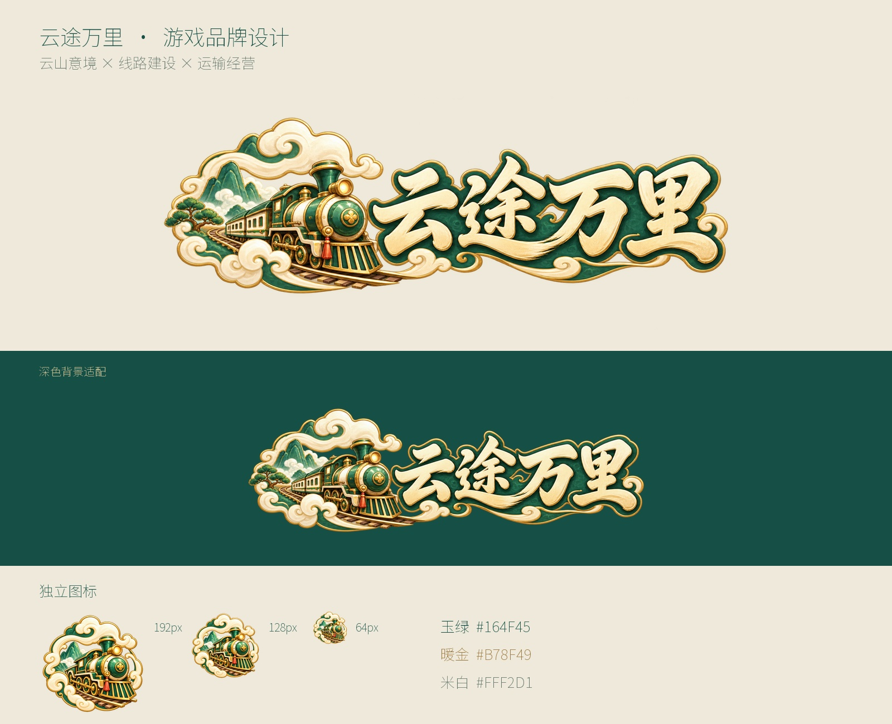

# 云途万里 · 游戏名称与 Logo

道家 Q 版运输经营游戏的正式名称为 **《云途万里》**。用户已授权采用该名称与本地 Logo 方案，并将品牌包整合进整款游戏美术交付。Logo 已完成本地核对；授权整合与最终审美批准分别记录，后者仍待用户确认。

“云”对应云山、流云与轻盈的东方气质；“途”对应交通线路的建设与连接；“万里”对应铁路、公路、水运和航空组成的运输网络不断延伸。名称可以容纳城镇、产业货流和公司经营，不局限于一种载具。

## 成品

- [透明主 Logo](logo-main.png)：原生 1860×845；用于启动页、主菜单与宣传图。
- [透明独立图标](logo-symbol.png)：原生 1254×1254；用于启动器及应用入口。
- 主 Logo 的 [1024px 宽版](logo-main-1024w.png)、[512px 宽版](logo-main-512w.png)。
- 独立图标的 [512px](logo-symbol-512.png)、[256px](logo-symbol-256.png)、[128px](logo-symbol-128.png)、[64px](logo-symbol-64.png)。
- [原生图与派生来源清单](manifest.json)、[本包检查结果](records/validation.json)、[实际图审](records/visual-review.json)。
- [8件正式PNG资源参数](../../docs/asset-branding-manifest.json)、[品牌专页](../../previews/branding/index.html)、[整合说明](../../docs/BRAND_INTEGRATION_DELIVERY.md)与[整合检查](../../records/brand-integration-validation.json)；全游戏导入索引见[ART_RESOURCE_INDEX](../../docs/ART_RESOURCE_INDEX.json)。

主字标采用米白厚笔画、玉绿轮廓与暖金细边。青绿列车、云山和弧形轨道将运输玩法与现有手绘风格联系起来。独立图标移除文字与长横向装饰，保留列车和云环。

## 使用

保持等比缩放。主 Logo 建议显示宽度至少 480px；小尺寸入口使用独立图标，128px 及以上更清楚，64px 保留轮廓、舍弃车轮窗格等细节。深绿与米白底均已实际查看；三处外轮廓另在白色、深绿、中灰底放大检查。

主菜单、启动与关于页统一使用正式名；品牌图像使用本包主标或独立图标，不在图片下再重复叠一套字标。功能窗口继续使用建设、经营、设置等明确标题。品牌标志是静态图片，经营数据、玩家名称与公司名称保持独立文字层。

以上交付为带真实 Alpha 的光栅 PNG。缩小版只是原生图的等比采样，不代表新增原生细节；未制作可编辑矢量路径。品牌展示板仅排版、缩放和合成现有图像。

## 生成与提示词

均通过宿主**内置 image_gen** 生成，没有使用 API/CLI 备用路径。实际提交、原生尺寸、参考图哈希与返回证据按图记录。配置目标保持本批启动时的 gpt-image-2.5-sunburst / max；工具无型号与质量选择器，实际模型和质量未披露，记录为 null。

- 主 Logo：[完整实际提示词](records/logo-main.prompt.txt)、[调用记录](records/logo-main-call.json)、[逐图记录](logo-main.png.generation.json)。
- 独立图标：[完整实际提示词](records/logo-symbol.prompt.txt)、[调用记录](records/logo-symbol-call.json)、[逐图记录](logo-symbol.png.generation.json)。
- 两张指定 UI 主参考已实际查看并附入两次调用；主 Logo 另附实际运输城镇拼装图，独立图标另附主 Logo 作为身份参考。

本包是整款游戏美术交付的品牌部分；正式资源登记和全游戏索引由最终整合流程统一更新。历史提示词、调用记录、原始生成图与早期关联原文按原貌保留，当前交付标题与文案合同使用正式名。先前全游戏终检只证明当时的输入版本，新增品牌的总计与检查结果以整合后重跑的独立终检为准。用户最终审美批准与后续游戏接入仍分别记录，本阶段没有 Unity 接入。
