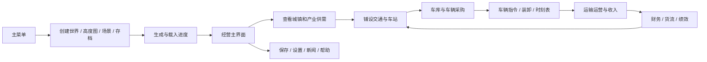
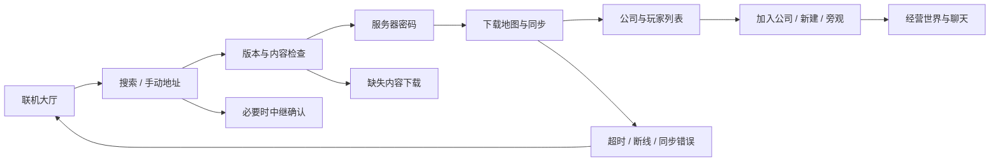

# 云途万里 · 文案、功能与流程合同

核实日期：2026-10-26（America/New_York）。功能参考：OpenTTD，提交 `cb7027538ccd8c4c15a592fc8f43b623b3fdf3f8`。本合同配套 `screen-catalog.json`，该 JSON 是全部界面中文文案、示例数据、必要状态、流程跳转和来源映射的单一数据清单。

## 游戏范围

参考游戏属于交通运输经营模拟。核心循环是：观察城镇与产业的供需 → 铺设交通基础设施 → 建造车站和车库 → 购买车辆 → 设置指令与时刻表 → 运输产生收入 → 维护、扩容和调整网络。铁路、公路（含有轨电车）、水运、航空均包含建设与运营界面。

149 个设计页映射到研究清单的 132 项已核实功能；227 个状态条目表达适用的空、失败、锁定、警告、确认、处理中与成功反馈。数量是目录规模，不自动表示图片已导出或通过验收。根制作流程应把每个条目的 `status` 与实际路径更新后再计为交付。

## 名称和样例文案

- 正式游戏名：**《云途万里》**；用户已授权采用名称与本地 Logo 并整合交付。主菜单、启动和关于页使用正式名及[品牌包](../branding/yuntu-wanli/README.md)，其他窗口使用功能标题。用户最终审美批准仍待确认。
- 青岚城、云岭城、江海镇、云途运输和云游子均为本任务排版样例；不冒称 OpenTTD 默认地图、真实服务器或已有玩家。
- 经营数据、车型名、脚本名、扩展包名、曲目名与数值均为静态样例。各页统一使用轻量页脚“界面设计预览 · 示例数据”，正文保留玩家需要的操作信息。
- 默认示例货币使用英镑 `£`，数量使用千分位；道路速度使用 km/h，煤炭等货物使用吨，旅客使用人，邮件使用袋。自定义货币窗口仅表现上游显示格式功能。
- 主要按钮使用明确动词，如“建造桥梁”“购买”“确认改装”“加入公司”；失败文案先写原因，再给可行返回路径。禁用状态不能只降透明度，必须同时说明条件。
- 新闻是经营事件通知；目标、故事书和脚本排行由 GameScript 提供；试用邀请、补贴与阶段评价按各自规则表达，不混为手动领奖系统。

## 已有功能、合理重排与不适用项目

全部目录条目 `origin=upstream` 表示存在相应功能依据；它不表示设计与上游窗口逐像素相同。主菜单归组、财务借还款放大确认、公司赠款确认、隧道放置预览等是已有动作的美术重排，其 `upstreamFeatureIds` 指向上游父功能。道家人物与交通设施外观是风格方案，不改变交通、货物与经济规则。

| 用户通用列举项目 | 本次处理 |
|---|---|
| 启动、更新、公告 | 基础资源引导与下载、主菜单、经营新闻；未新增强制启动器更新服务 |
| 登录、服务器、角色创建 | 上游无必需账号登录；保留联机服务器/公司密码、玩家名称、公司经理形象 |
| 角色属性、技能、装备 | 不适用；经理头像不扩展为RPG角色养成 |
| 背包、仓库、物品数量 | 不适用；货物显示在车站候运、车辆容量与货流中 |
| 任务、目标、奖励 | GameScript目标/问题/故事；运输补贴与阶段评分；无额外签到领取假设 |
| 地图、区域、传送 | 地图、观察视窗、定位、路牌；没有传送机制 |
| 战斗操作与结算 | 不适用；阶段评价属于经营成绩 |
| 商店、购买、出售 | 四类车辆采购/出售、产业资助、公司收购、借还款等真实经营功能 |
| 活动、签到、成就、排行 | 经营目标、试用邀请、公司/脚本排行和历史高分；未新增签到或活动服务 |
| 好友、聊天、邮件 | 多人世界/公司/私聊与平台整合；不新增好友、帮会或附件邮件 |
| 研究、生产队列、部队 | 车型按年代/内容可用；产业有供需与生产；无科技研究树或部队系统 |

## 核心流程

## 页面与状态合同

`screen-catalog.json` 每项含系统、标题、布局、图标、页签、列、列表数据、侧栏资料、动作、适用状态、来源和后续流程。`flowTo` 均为目录中真实存在的完整 ID。`source` 是相对参考仓库的源码路径与一基行号；来源核实方法见 `OPENTTD_RESEARCH.md`。

`states` 是静态状态设计要求，所有 `previewOnly=true`。它们不证明真实下载、联网、购买、保存、运行或报错已经执行。验收应分别确认底图/文案/控件的视觉状态；后续业务回执验证留待接入阶段。

同一窗口的分类页签使用同套控件和对齐。五个公司指标、五个设置类别、四类车辆总览、四类采购、四类车库均有独立完整设计页。其他页签改变对象筛选、字段范围或子资料，详见每项 `tabNotes`；当页签仅用于同逻辑数据分类时，以当前整屏配合状态与文案说明表达，不声称每个数据组合都有独立图片。

### 重要控件与反馈

| 场景 | 必须表现 |
|---|---|
| 建设施工 | 当前工具/方向/覆盖/选区预览/Shift费用预估/地形占用或资金失败 |
| 铁路 | 四向铺轨、自动铺轨、车站、车库、路点、信号、桥隧、转换；R为移除轨道，6为拆除建筑 |
| 车站 | 候运与货物评级分离；来源/经由/目的地按货运模式；机场关闭状态只作用航空设施 |
| 车辆 | 启动停止、送库、跟随、详情；其他公司只读；迷路、故障、停运与正常区分 |
| 指令 | 前往、跳过、删除、装卸、转运、不停站、条件跳转、共享；取消共享不出售车辆 |
| 时刻表 | 计划/预计到发、速度限制、开始日期、自动填充、晚点；缺时长与填充中各自反馈 |
| 财务 | 可用资金、贷款、收入与成本；借款上限/还款余额失败清楚；没有充值或商城兑换 |
| 内容下载 | 依赖选择/缺失/不兼容/进度/取消/失败/完成；不承诺未经源码证实的断点续传 |
| 多人 | 服务器兼容性/人数/密码/缺失包；公司权限/观察者；管理员专用操作独立禁用 |
| 脚本 | AI与GameScript分开；无目标/无故事/无脚本排行是有效空态，不假造默认剧情 |
| 通用对话框 | 明确操作标题、原因、主动作与取消；返回原窗口时恢复选中位置 |

## 图表和评分校准

经营利润、运输收入、交付运量、绩效历史和公司价值是不同指标，各有整屏，图例可按公司开关。货物支付率、产业生产、城镇货物与帧时间另有专用图表。美术中的曲线和值都是静态示意。

绩效九类权重依据 `src/economy.cpp:94`：车辆100、站点100、最低车辆利润100、最低季度收入50、最高季度收入100、交付货量400、货物类别50、现金50、贷款50，总分1000。示例分项 23+15+41+50+100+345+37+1+30=642，不把货物种类误记为400分。

## 上游132项逐项映射

下表只证明每项有设计入口；图片、独立资源和最终验收仍以主交付清单的实际状态为准。

| 上游功能ID | 已核实功能 | 对应设计页 |
|---|---|---|
| bootstrap | 首次资源检查与下载 | 02-bootstrap |
| intro | 游戏主菜单 | 01-main-menu |
| world-generation | 随机世界生成 | 03-new-world |
| heightmap | 高度图导入与生成 | 04-heightmap |
| load | 读取存档与文件详情 | 06-load-game |
| save | 保存与覆盖确认 | 07-save-game |
| scenario-load | 情景选择 | 05-scenario-select、133-town-data-import |
| world-progress | 生成与加载进度 | 08-world-progress |
| hud | 经营主界面与工具栏 | 09-main-hud、10-game-menu |
| statusbar | 日期资金与滚动新闻 | 09-main-hud |
| map | 全局地图 | 69-small-map |
| cargo-flow-map | 货流网络与图例 | 70-linkgraph |
| extra-view | 额外观察视窗 | 71-extra-viewport |
| transparency | 透明与隐藏工具栏 | 72-transparency |
| land-info | 土地信息 | 73-land-info |
| sign-list | 路牌列表 | 74-signs |
| sign-edit | 路牌编辑 | 75-sign-edit |
| rail-toolbar | 铁路建设工具 | 11-rail-build、16-rail-convert、18-tunnel |
| rail-station | 铁路车站选择与覆盖 | 12-rail-station |
| rail-depot | 铁路车库方向选择 | 14-rail-depot |
| rail-waypoint | 铁路路点选择 | 15-rail-waypoint |
| signal | 铁路信号选择与转换 | 13-rail-signals |
| bridge | 桥梁类型与成本 | 17-bridge |
| station-join | 站点与路点合并 | 30-station-join |
| road-toolbar | 公路建设工具 | 19-road-build |
| tram-toolbar | 有轨电车建设工具 | 20-tram-build |
| road-depot | 公路与电车车库 | 22-road-depot |
| bus-stop | 客运站选择与覆盖 | 21-road-station |
| truck-stop | 货运站选择与覆盖 | 21-road-station |
| road-waypoint | 公路路点 | 23-road-waypoint |
| water-toolbar | 水运建设工具 | 24-water-build、27-canal-lock |
| water-depot | 船坞方向 | 26-shipyard |
| water-station | 码头与覆盖 | 25-dock |
| airport-toolbar | 航空建设工具 | 28-airport-build |
| airport-picker | 机场类型与布局 | 29-airport-picker |
| terraform | 地形整治工具 | 129-terraform |
| trees | 种植树木 | 130-trees |
| objects | 景观对象选择 | 131-objects |
| station-list | 公司站点列表 | 31-stations-list |
| station-view | 站点详情与候运 | 32-station-detail、33-station-ratings |
| airport-close | 机场临时关闭 | 32-station-detail |
| waypoint-view | 路点与浮标详情 | 34-waypoint-detail |
| vehicle-list-train | 列车与分组 | 35-vehicles-train、54-vehicle-groups |
| vehicle-list-road | 公路车辆与分组 | 36-vehicles-road |
| vehicle-list-ship | 船舶与分组 | 37-vehicles-ship |
| vehicle-list-air | 航空器与分组 | 38-vehicles-air |
| vehicle-depot | 车库与编组 | 39-depot-train、40-depot-road、41-depot-ship、42-depot-air |
| vehicle-buy | 购买交通工具 | 43-buy-train、44-buy-road、45-buy-ship、46-buy-air |
| vehicle-view | 交通工具控制 | 47-vehicle-view |
| vehicle-details | 交通工具详细参数 | 48-vehicle-details |
| vehicle-refit | 货舱改装 | 49-vehicle-refit |
| vehicle-replace | 自动替换与续购 | 55-auto-replace |
| vehicle-orders | 路线命令列表 | 50-orders、52-shared-orders |
| conditional-orders | 条件命令与检修分流 | 51-conditional-order |
| vehicle-timetable | 时刻表与速度限制 | 53-timetable |
| set-date | 日期与时刻选择 | 125-date-picker |
| engine-preview | 新车型试用邀请 | 56-engine-preview |
| company | 公司信息与总部 | 57-company-overview |
| finance | 财务报表与贷款 | 60-finances、61-loan |
| livery | 公司与分组涂装 | 59-company-livery |
| manager-face | 经理形象与姓名 | 58-company-manager |
| infrastructure | 基础设施统计与维护 | 62-infrastructure |
| company-buy | 收购与并购确认 | 63-buy-company |
| town-list | 城镇目录 | 76-towns |
| town-view | 城镇详情 | 77-town-detail |
| town-authority | 地方当局与行动 | 78-town-authority |
| town-found | 创建城镇 | 79-found-town |
| industry-list | 产业目录 | 80-industries |
| industry-view | 产业详情与生产 | 81-industry-detail |
| industry-build | 资助产业与勘探 | 82-fund-industry |
| cargo-chain | 产业货物流转关系 | 83-cargo-chain |
| subsidies | 运输补贴 | 68-subsidies |
| news | 新闻通知 | 86-news |
| news-history | 新闻历史列表 | 87-news-history |
| goals | 脚本目标列表 | 88-goals |
| goal-question | 脚本问题与选择 | 89-goal-question |
| story | 故事书与互动页面 | 90-story-book |
| company-league | 公司排行 | 64-company-league |
| script-league | 脚本排行榜 | 149-script-league |
| highscore | 历史高分 | 91-highscores |
| endgame | 阶段结算 | 92-endgame |
| income-graph | 收入图表 | 65-company-graphs |
| profit-graph | 营业利润图表 | 145-profit-graph |
| cargo-graph | 运量图表 | 146-cargo-graph |
| performance-graph | 绩效历史 | 147-performance-graph |
| value-graph | 公司价值 | 148-value-graph |
| cargo-rates | 货物运价 | 67-cargo-payment |
| performance-detail | 绩效评分详情 | 66-performance |
| industry-production | 产业生产历史 | 84-industry-production |
| town-cargo | 城镇货物历史 | 85-town-cargo |
| network-list | 服务器列表与详情 | 93-servers |
| network-start | 创建服务器 | 94-server-create |
| network-join | 连接进度与断线 | 95-network-join |
| network-password | 服务器与公司密码 | 96-network-password |
| network-clients | 玩家与公司列表 | 97-clients、99-gift-money |
| network-chat | 世界公司与私聊 | 98-chat |
| network-relay | 中继连接确认 | 100-relay-consent |
| network-survey | 调查与隐私选项 | 101-survey-consent |
| content-list | 在线内容浏览 | 102-online-content |
| content-download | 内容下载进度 | 103-content-download |
| newgrf | NewGRF 管理 | 104-newgrf、107-content-scan |
| newgrf-params | NewGRF 参数 | 105-newgrf-parameters |
| newgrf-preset | 扩展预设 | 106-newgrf-presets |
| content-text | 内容说明许可与变更 | 108-content-text |
| ai-config | AI 对手配置 | 109-ai-config |
| gs-config | GameScript 配置 | 110-gs-config |
| script-list | AI/GS 脚本选择 | 111-script-list |
| script-settings | AI/GS 参数设置 | 112-script-settings |
| script-debug | 脚本日志与异常 | 113-script-debug |
| settings | 通用设置 | 114-options、115-graphics-options、116-sound-options、117-social-options |
| advanced-settings | 高级设置树 | 118-advanced-options |
| currency | 自定义货币 | 119-custom-currency |
| music | 音乐音效与曲目 | 120-music-player |
| music-tracks | 播放列表编辑 | 121-music-tracks |
| help | 帮助中心 | 122-help |
| about | 关于与制作人员 | 123-about |
| screenshot | 截图导出选择 | 124-screenshot |
| scenario-create | 新建情景 | 126-scenario-create |
| scenario-hud | 情景编辑主工具栏 | 127-scenario-editor |
| scenario-terrain | 编辑器地形生成 | 128-editor-terrain |
| scenario-house | 房屋选择放置 | 132-build-house |
| cheats | 沙盒作弊与限制 | 134-sandbox |
| console | 控制台 | 135-console |
| newgrf-inspect | NewGRF 对象检查 | 136-newgrf-inspect |
| sprite-align | 精灵对齐工具 | 137-sprite-align |
| framerate | 帧率与性能 | 138-performance-monitor |
| frametime | 帧时间历史 | 139-frame-time |
| error | 错误通知 | 140-generic-error |
| tooltip | 悬停说明与预估费用 | 141-tooltip-cost |
| input-query | 名称数量与输入 | 142-input-query |
| confirm | 通用确认取消 | 143-confirm |
| osk | 屏幕键盘 | 144-on-screen-keyboard |

## 布局与文字约定

参考画布1920×1080，中文标题使用书写气质的衬线字，正文和数值使用清晰中文无衬线字；字体实际文件、许可与字号由统一资源/导入文档指定。动态标题、公司/玩家名、数量、按钮文案、正文与图表标签分离。固定图标符号允许绘入素材，必须在资源清单注明。

玉绿主动作、米白次动作、暖金细边、朱砂失败与提醒、灰青禁用；禁用和未开放还需文字说明。正负财务数字除颜色外保留正负号。地图图例有标签与线型辅助，不能只靠颜色识别。

弹窗、选择和筛选状态沿用同一控件画布、边距与锚点。ScrollRect、键盘焦点、IME、鼠标拖拽、工具提示跟随、图表动态刻度和超长文字需在后续Unity接入验证；当前交付是图片、美术资源与状态流程说明。
